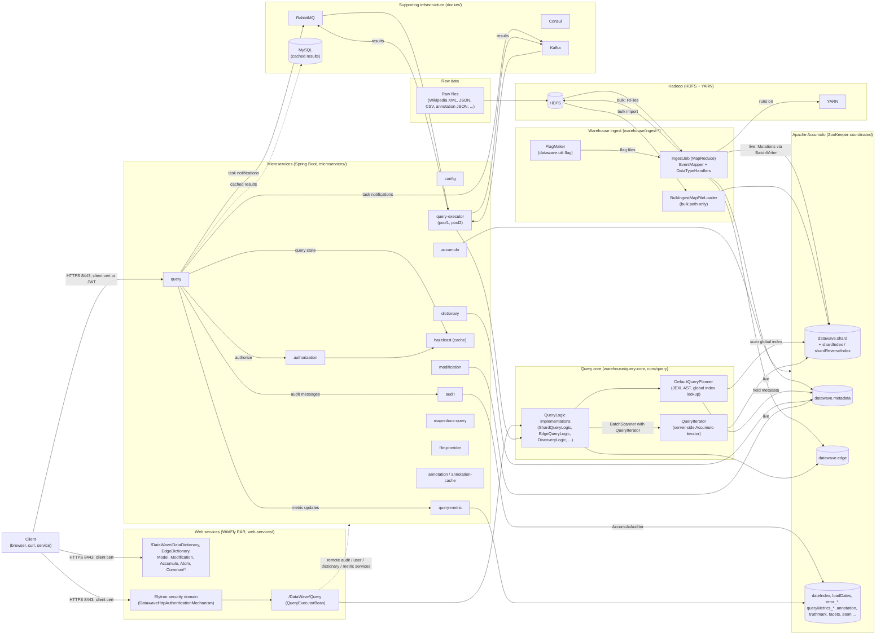
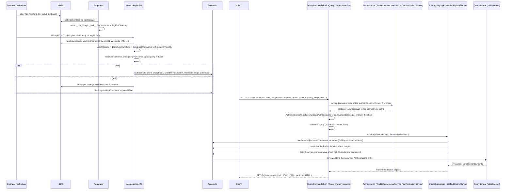
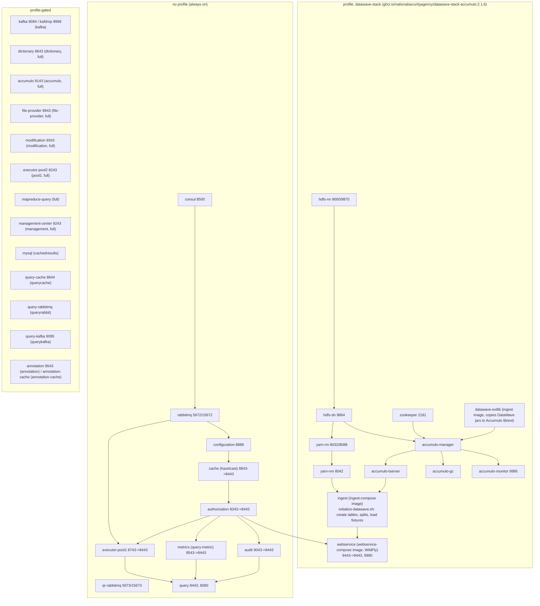

# DataWave system overview

This document describes the DataWave system as it exists in this repository. Every statement is taken from the code, build files, scripts or configuration checked into the repo at the time of writing. Where something is a reading of the code rather than something the code states directly, it is marked **(inferred)**.

Sources read for this document: `README.md`, `pom.xml` module trees, `warehouse/`, `core/`, `commons/`, `web-services/`, `microservices/`, `docker/` (compose file, `config/`, `stack/`, `pki/`, `scripts/`), `contrib/datawave-quickstart/`, `contrib/datawave-test-pki/`, `properties/*.properties`, and `git log` for the last two years.

## 1. Component diagram

Read the diagram as two query front doors over one Accumulo warehouse: the older WildFly EAR under `web-services/` and the newer Spring Boot services under `microservices/`. Both call the same query-core classes. The `docker/docker-compose.yml` runs both at once (`webservice` plus the microservices) against one Accumulo.

## 2. Components

### 2.1 Warehouse ingest (`warehouse/ingest-*`)

| Module | What the code shows |
|---|---|
| `warehouse/ingest-core` | `datawave.ingest.mapreduce.job.IngestJob` is the MapReduce driver. Its class comment says it creates Accumulo map files for bulk import, or writes `Mutation`s directly when `-outputMutations` is given. `datawave.ingest.mapreduce.EventMapper` reads events and hands each one to the configured `DataTypeHandler` implementations. Handlers under `mapreduce/handler/` cover `shard` (`ShardedDataTypeHandler`, `AbstractColumnBasedHandler`), `edge` (`ProtobufEdgeDataTypeHandler`), `dateindex`, `error`, `facet`, `atom`, `stats`, `summary`, `tokenize`. `datawave.util.flag.FlagMaker` polls HDFS input directories and writes flag files to a local directory that `IngestJob` consumes (`-flagFileDir`, `-flagFilePattern`). `BulkIngestMapFileLoader` imports bulk RFiles into Accumulo. |
| `warehouse/ingest-configuration` | Per-datatype ingest configuration (XML) packaged into the ingest distribution. |
| `warehouse/ingest-csv`, `ingest-json`, `ingest-wikipedia`, `ingest-annotation`, `ingest-nyctlc`, `ingest-ssdeep` | Format-specific `InputFormat`/record readers and ingest helpers. The docker stack uses `datawave.ingest.wikipedia.WikipediaEventInputFormat`, `datawave.ingest.json.mr.input.JsonInputFormat`, `datawave.ingest.csv.mr.input.CSVFileInputFormat` and `datawave.ingest.annotation.mapreduce.input.SimpleAnnotationInputFormat` (`docker/stack/initialize-datawave.sh`). |
| `warehouse/ingest-scripts` | Shell operations: `live-ingest.sh` and `bulk-ingest.sh` build the `hadoop jar ... IngestJob` command line; `map-file-bulk-loader.sh` runs `BulkIngestMapFileLoader`; `create-all-tables.sh`, `flag-maker.sh`, `start-ingesters.sh`, `load-job-cache.sh` and others. |
| `warehouse/age-off`, `age-off-utils` | Accumulo iterator `Filter`s (`ConfigurableAgeOffFilter`, `DataTypeAgeOffFilter`, `MaximumAgeOffFilter`) that drop data by age at scan/compaction time. |
| `warehouse/accumulo-extensions`, `index-stats`, `metrics-core`, `ops-tools` | Accumulo-side helpers, index statistics, ingest metrics, and operator tools. |

Two ingest modes are visible in `IngestJob` and the scripts:

- **Live ingest** (`live-ingest.sh`, flag pattern `.*_(live|fivemin)_.*\.flag`): the job writes `Mutation`s through `CBMutationOutputFormatter` directly to Accumulo tablet servers.
- **Bulk ingest** (`bulk-ingest.sh`, flag pattern `.*_(bulk|onehr)_.*\.flag`): the job writes RFiles through `MultiRFileOutputFormatter` into a work directory on HDFS; `BulkIngestMapFileLoader` then bulk-imports them. `IngestJob` can `distcp` the files from an ingest HDFS (`-srcHdfs`) to the warehouse HDFS (`-destHdfs`).

Ingest also enforces `VisibilityConstraint`s on every Accumulo column visibility it writes (`datawave.ingest.mapreduce.job.VisibilityConstraint`, `ConstraintChecker`).

### 2.2 Accumulo tables

Table names come from `properties/default.properties` (`table.name.*`). The docker stack creates them with `create-all-tables.sh` inside the `datawave` namespace (`docker/stack/initialize-datawave.sh`).

| Property | Default table | Written by | Read by |
|---|---|---|---|
| `table.name.shard` | `datawave.shard` | `ShardedDataTypeHandler` | `QueryIterator` via `ShardQueryLogic` |
| `table.name.shardIndex` / `shardReverseIndex` | `datawave.shardIndex`, `datawave.shardReverseIndex` | shard handler | `DefaultQueryPlanner` range stream, `DiscoveryLogic`, `ShardIndexQueryTable` |
| `table.name.shardDayIndex`, `shardYearIndex`, `dateIndex` | `datawave.shardDayIndex`, `datawave.shardYearIndex`, `datawave.dateIndex` | shard / `DateIndexDataTypeHandler` | planner date handling |
| `table.name.metadata` | `datawave.metadata` | ingest handlers; `modification` service | `MetadataHelper` in query-core; `dictionary` service; the `num_shards` row read by the query side (`initialize-datawave.sh`) |
| `table.name.shardStats` | `datawave.shardStats` | `ShardStatsDataTypeHandler` | query-core statistics |
| `table.name.edge` | `datawave.edge` | `ProtobufEdgeDataTypeHandler` | `EdgeQueryLogic`, edge dictionary |
| `table.name.errors.*` | `datawave.error_s`, `error_i`, `error_r`, `error_m` | `error` handler | error query logics (`errorQuery.sh`, `errorDiscovery.sh` in `docker/scripts`) |
| `table.name.queryMetrics.*` | `datawave.queryMetrics_s`, `_i`, `_r`, `_m`, `_di` | `query-metric` service / `web-services/metrics` | query metric queries |
| `table.name.loadDates` | `datawave.loadDates` | ingest | query-core |
| `table.name.annotation(.source)`, `truthmark(.source)` | `datawave.annotation`, `annotationSource`, `truthmark`, `truthmarkSource` | annotation ingest; `annotation` service | `annotation` service |
| `table.name.facet*`, `atom.categories` | `datawave.facets`, `facetMetadata`, `facetHashes`, `datawave.atom` | `facet` / `atom` handlers | faceted query planner, `web-services/atom` |

Shard-table layout, from `warehouse/query-core/.../Constants.java` and the shard handler: row = `yyyyMMdd_<shard>` (`table.shard.numShardsPerDay=10` in the default properties), column families `datatype\0uid` for event fields, `fi\0FIELD` for the field index, `tf` for term frequencies and `d` for document content. `docker/stack/shard-splits.txt` pre-splits `datawave.shard` by shard id.

Every key carries an Accumulo `ColumnVisibility`. `ShardedDataTypeHandler` takes it from the event (`event.getVisibility()`) or from `MarkingFunctions` (`markings.toColumnVisibility()`) and normalises it before writing.

### 2.3 Query core (`warehouse/query-core`, `core/query`)

- `datawave.query.tables.ShardQueryLogic` — the class comment calls it the "QueryTable implementation that works with the JEXL grammar" that "uses the DATAWAVE metadata, global index, and sharded event table to return results". Sibling logics in the same package include `IndexQueryLogic`, `CountingShardQueryLogic`, `AncestorQueryLogic`, `ParentQueryLogic`, `RemoteEventQueryLogic`, `RemoteEdgeQueryLogic`, and `ShardIndexQueryTable`; `datawave.query.discovery` and `datawave.query.edge` hold discovery and edge logics.
- `datawave.query.planner.DefaultQueryPlanner` — builds and rewrites the JEXL abstract syntax tree (`datawave.query.jexl`), consults `datawave.metadata` through `MetadataHelper`, and uses the global index to turn the query into Accumulo ranges (`ThreadedRangeBundler`, `datawave.query.index`). Other planners: `IndexQueryPlanner`, `FacetedQueryPlanner`, `DatePartitionedQueryPlanner`, `BooleanChunkingQueryPlanner`.
- `datawave.query.iterator.QueryIterator` — the server-side Accumulo iterator. Its class comment lists the pipeline: filter on timestamp, build the `Document`, "compute top-level visibility and apply to Document Key", JEXL evaluation, post-processing enrichment, serialise (Kryo/Writable). `datawave.query.iterator.ivarator` spills large term/UID sets to HDFS or local disk.
- `datawave.query.language` and `datawave.query.lucene` parse LUCENE syntax into JEXL. `datawave.query.transformer` turns `Document`s into response objects. `datawave.query.model` applies query models.
- `core/query` holds the container-neutral `QueryLogic` API, `CompositeQueryLogic`, and `datawave.core.query.logic` shared by both front ends; `core/connection-pool` holds the Accumulo connection factory; `core/in-memory-accumulo` is the in-memory Accumulo used by tests.

### 2.4 Web services (`web-services/`, WildFly)

A Jakarta EE EAR assembled by `web-services/deploy/application` and deployed on WildFly (`quay.io/wildfly/wildfly:26.1.3.Final-jdk11` in the Dockerfile; the quickstart downloads WildFly and starts `standalone.sh -c standalone-full.xml`). JAX-RS paths found in `@Path` annotations:

| Module | Root path(s) |
|---|---|
| `web-services/query` | `/Query` — `listQueryLogic`, `{logicName}/define`, `create`, `plan`, `predict`, `createAndNext`, `async/create`, `{id}/next`, `reset`, `close`, `cancel`, `lookupUUID`, `lookupContentUUID`, `generateTagCloud`, `{id}/plan` (`QueryExecutorBean`) |
| `web-services/query-websocket` | WebSocket `@ServerEndpoint("/{logic-name}")` (`QueryWebsocket`) |
| `web-services/dictionary` | `/DataDictionary`, `/EdgeDictionary` |
| `web-services/model` | `/Model` (`list`, `import`, `insert`, `delete`, `clone`) |
| `web-services/modification` | `/Modification` (`listConfigurations`, `getMutableFieldList`, `reloadCache`) |
| `web-services/accumulo` | `/Accumulo` (`ListTables`, `ListUsers`, `Stats`, `Update`) |
| `web-services/atom` | `/Atom`, `/categories` |
| `web-services/common` | `/Common/Auditor/audit`, `/health`, `/info`, `/refresh`, `/shutdown`, `/stats`, `/status` |
| `web-services/cached-results` | cached-results beans backed by a JDBC `DataSource` (`CachedResultsBean`, `CachedRunningQuery`) |
| `web-services/metrics` | query metric recording |
| `web-services/security-parent` | Elytron security realm, HTTP authentication mechanism, user cache (see §4) |

The EAR context roots are set in `web-services/deploy/application/pom.xml`: `/DataWave` for the main web application, `/DataWave/Query/websocket` for the WebSocket module and `/DataWave/doc` for the generated documentation. The quickstart prints `https://localhost:8443/DataWave/doc` and `https://localhost:8443/DataWave/DataDictionary` as entry points (`bootstrap-web.sh`).

`add-datawave-configuration.cli` wires the EAR to remote microservices through system properties `dw.remoteDatawaveUserService.*`, `dw.remoteDatawaveAuditService.*`, `dw.remoteDictionary.*`, `dw.remoteAccumuloService.*` and `dw.remoteQueryMetricService.*` (host, port, and SRV DNS lookup). The quickstart defaults to a local `TestDatawaveUserService` unless `DW_ENABLE_REMOTE_AUTH_SERVICE=true` (`bootstrap-user.sh`).

### 2.5 Microservices (`microservices/`, Spring Boot / Spring Cloud)

Every service is built on `microservices/starters/datawave` (security, Accumulo client config, Consul/RabbitMQ discovery, marking functions, metrics). Service, context path and port follow `server.servlet.context-path: /${spring.application.name}`, `server.port: 8443`, `server.non-secure-port: 8080` (`docker/config/application.yml`).

| Service | Code | Role shown by code/README | Depends on |
|---|---|---|---|
| `config` | `services/config` | Spring Cloud Config server; compose runs it with profiles `consul,native` and `--spring.cloud.config.server.native.searchLocations=file:///microservice-config` (the `docker/config` folder) | RabbitMQ (for config refresh bus) **(inferred from `depends_on`)** |
| `authorization` | `services/authorization` | `GET /authorization/v1|v2/authorize` returns a signed JWT holding a list of `DatawaveUser`; `whoami`; OAuth2-style `v2/oauth/authorize`, `token`, `user`, `users`; admin cache eviction. Caches users in Hazelcast | `cache` (hazelcast) |
| `hazelcast` | `services/hazelcast` | Hazelcast in-memory data grid used as the shared cache (`cache` and `query-cache` instances in compose) | config |
| `query` | `services/query` | User-facing REST API `/query/v1/*` mirroring the EAR `/Query` API (`QueryController`), plus `/query/v1/mapreduce/*` (`MapReduceQueryController`), cached results (`CachedResultsQueryController`), `WebController`, `PoolHealthController`. `QueryManagementService` defines/creates/plans queries in `QueryStorageCache`, publishes executor events, and talks to `AuditClient` | audit, authorization, metrics, executor-pool1 |
| `query-executor` | `services/query-executor` | "Business logic for handling a task notification" (`QueryExecutor`): picks up tasks from the storage cache, runs the query logic against Accumulo through `AccumuloConnectionFactory`, publishes results through `QueryResultsManager` | rabbitmq, authorization, metrics |
| `audit` | `services/audit` | Consumes audit messages from a Spring Cloud Stream destination `audit` (RabbitMQ binder in `docker/config/audit.yml`); `FileAuditor`, `AccumuloAuditor`, `LogAuditor`; `ReplayController` | authorization |
| `query-metric` | `services/query-metric` | `/querymetric/v1/updateMetric(s)`, `/id/{queryId}`, `/summary/*`, `/cacheStats`; Hazelcast-backed with persistence into the `datawave.queryMetrics_*` tables | authorization, ingest (tables must exist) |
| `dictionary` | `services/dictionary` | `/dictionary/data/v1/*` data dictionary, `EdgeDictionaryController`, `ModelController`; reads `datawave.metadata` | authorization |
| `accumulo` | `services/accumulo` | `/accumulo/v1/lookup/{table}/{row}`, `/v1/admin/*` (grant/revoke permissions, create table), `/v1/stats`; `@Secured({"InternalUser","Administrator"})` | authorization |
| `modification` | `services/modification` | `/modification/v1/listConfigurations`, `PUT /v1/{modificationServiceName}/submit`; mutable metadata | authorization |
| `mapreduce-query` | `services/mapreduce-query` | MapReduce-backed query jobs (`jobs`, `layout-factory`) | audit, authorization, metrics, executor |
| `file-provider` | `services/file-provider` | file management and access for other services (README in `docker/README.md`) | authorization |
| `annotation`, `annotation-cache` | `services/annotation*` | `/annotation/v1/*` read/write of annotations over the `annotation`/`truthmark` table pairs with an ack/retry write pipeline; runs in `api`, `writer` or `combined` roles | config, rabbitmq |

Query-state and results transport between `query` and `query-executor` is pluggable: `microservices/starters/query/.../messaging` has `rabbitmq`, `kafka` and `hazelcast` implementations of `QueryResultsManager`/`Publisher`/`Listener`, selected by `datawave.query.messaging.backend`, which reads the `BACKEND` environment variable. `docker/docker-compose.yml` sets `BACKEND=${BACKEND:-rabbitmq}` on the query, executor and related services, so a plain `docker compose up` uses RabbitMQ; the `${BACKEND:kafka}` fallback in `docker/config/application-compose.yml` only applies when the variable is absent altogether (for example when a service is started outside compose).

## 3. Data flow: raw file to query result

Step by step, as the code shows it:

1. **Land the file.** Raw files are copied into HDFS (`docker/stack/initialize-datawave.sh` copies the fixtures under `/datawave/ingest/...`). In a running system `FlagMaker` polls the configured HDFS input directories (`FlagMakerConfig.hdfs`, `baseHDFSDir`) and writes flag files listing the files to process into a local directory (`FlagMakerConfig.flagFileDirectory`, written with `java.io.File`), which `IngestJob` reads through `-flagFileDir`.
2. **Run the job.** `live-ingest.sh` or `bulk-ingest.sh` launches `datawave.ingest.mapreduce.job.IngestJob` on YARN with the datatype's `InputFormat`, the Accumulo instance/ZooKeepers, a job cache of jars in HDFS, and the flag directory.
3. **Map.** `EventMapper` parses each record into a `RawRecordContainer` using the datatype's ingest helper, then calls every configured `DataTypeHandler`. Handlers emit `BulkIngestKey`/`Value` pairs for the shard, index, reverse index, metadata, edge, date index and other tables. The event's security markings are converted to a `ColumnVisibility` and checked against `VisibilityConstraint`s.
4. **Shuffle and reduce.** `BulkIngestKeyDedupeCombiner` removes duplicates, `DelegatingPartitioner` partitions per table, `BulkIngestKeyAggregatingReducer` aggregates.
5. **Write.** Live: `CBMutationOutputFormatter` writes `Mutation`s to Accumulo. Bulk: `MultiRFileOutputFormatter` writes RFiles to the work directory; `BulkIngestMapFileLoader` imports them. The job writes marker/flag files to report progress.
6. **Query request.** A client calls the EAR (`/DataWave/Query/{logic}/create`) or the query service (`/query/v1/{logic}/create`) over HTTPS with a client certificate. Parameters include `query`, `auths`, `columnVisibility`, `begin`, `end`, `pagesize`, `queryName` (`QueryParameters`).
7. **Authenticate and authorise.** The container extracts the X.509 subject/issuer DN and any proxied-entity chain, looks up each entity's `DatawaveUser` (roles and Accumulo auths), and builds the effective `Set<Authorizations>` with `AuthorizationsUtil.getDowngradedAuthorizations` (used by `QueryExecutorBean` and `CompositeQueryLogic`): the requested `auths` must be a subset of the primary user's auths (otherwise `AuthorizationException`), the primary user's entry becomes the intersection of the requested auths with that user's auths, and every other entity in the proxy chain contributes its own `Authorizations` entry unchanged (`UserAuthFunctions.mergeAuthorizations`). The set is handed to the query logic, which scans with all of them so that Accumulo only returns cells visible to every entity in the chain **(inferred: how the scanner consumes the set is in Accumulo/query-core, not re-verified here)**.
8. **Audit.** The EAR posts to its `AuditBean` or `RemoteAuditor`; the query service uses `AuditClient`. The audit service persists via file, Accumulo or log auditors.
9. **Plan.** `ShardQueryLogic` builds a `ShardQueryConfiguration`; `DefaultQueryPlanner` parses JEXL (or LUCENE translated to JEXL), expands against `datawave.metadata`, looks up terms in `datawave.shardIndex`/`shardReverseIndex`, and produces shard ranges with a serialised iterator configuration (`QueryOptions`).
10. **Execute.** A `BatchScanner` runs `QueryIterator` on the tablet servers. Accumulo filters keys by the scanner's `Authorizations` against each key's `ColumnVisibility` before `QueryIterator` sees them; `QueryIterator` then evaluates the JEXL expression per document, computes the document's top-level visibility, and serialises matches.
11. **Return.** Transformers build response objects; `next` pages are returned in the `@Produces` formats (`application/xml`, `application/json`, YAML, `application/x-protobuf`, `text/html`). In the microservice path the executor publishes results to the messaging backend and the query service's `next` reads them from there. Query metrics are recorded to the `queryMetrics_*` tables.

## 4. External interfaces, protocols and authentication

### 4.1 Interface table

Ports are the container-side defaults from `docker/config/application.yml`, the WildFly Dockerfile and `docker/docker-compose.yml` (host:container).

| Interface | Protocol | Port (compose host:container) | Authentication | Authorisation / data protection |
|---|---|---|---|---|
| WildFly EAR REST (`/DataWave/*`) | HTTPS (TLS 1.1–1.3 per `add-datawave-configuration.cli`); JAX-RS; XML/JSON/YAML/protobuf/HTML | `webservice` 9443:8443; mgmt 9990:9990 | Mutual TLS client certificate (`want-client-auth=true` on `serverSSLContext`). `DatawaveHttpAuthenticationMechanism` accepts: X.509 certificate from the SSL session; or trusted headers `X-SSL-ClientCert-Subject` / `X-SSL-ClientCert-Issuer` from a load balancer; or `Authorization: Bearer <JWT>`. Proxy chains are passed in `X-ProxiedEntitiesChain` / `X-ProxiedIssuersChain` (issuers header required when entities header present). | Roles from `DatawaveUser` via `DatawaveRoleDecoder`; EJB `@RolesAllowed`; one Accumulo `Authorizations` per entity in the proxy chain (primary user's downgraded to the requested `auths`); Accumulo cell-level `ColumnVisibility` enforced by the tablet server. |
| WildFly WebSocket query (`/{logic-name}` under `query-websocket`) | WSS, JSON messages (`JsonQueryMessageDecoder`, `QueryResponseMessageJsonEncoder`) | same listener | Same Elytron security domain (`WebsocketSecurityConfigurator`) | as above |
| WildFly Atom feed | HTTPS, Atom XML | `dw.atom.externalPort` system property | same | same |
| Microservice REST (`/<service>/v1/...`) | HTTPS; Spring MVC; JSON/XML/protostuff | `query` 8443:8443 (8080 plain); `authorization` 8343:8443; `audit` 9043:8443; `metrics` 8543:8443; `dictionary` 8643:8443; `accumulo` 9143:8443; `executor-pool1` 8743:8443; `executor-pool2` 8243:8443; `modification` 9343:8443; `file-provider` 8943:8443; `annotation` 9543:8443; `cache` 8843:8443 | `server.ssl.client-auth: WANT`. `ProxiedEntityX509Filter` reads the client certificate or trusted headers `X-SSL-clientcert-subject` / `X-SSL-clientcert-issuer`, plus `X-ProxiedEntitiesChain` / `X-ProxiedIssuersChain`; `issuers-required: true`. `RemoteAuthorizationServiceUserDetailsService` calls `datawave.authorization.uri` (`https://authorization:8443/authorization/v1/authorize`). Subsequent calls may carry the returned JWT (`JWTAuthenticationFilter`, `jwt.ttl: 86400` s). Optional `enforce-allowed-callers` whitelist of `subjectDN<issuerDN>` strings. | Spring Security roles (`@Secured`, `requiredRoles: AuthorizedUser, AuthorizedServer, AuthorizedQueryServer`, `manager-roles: Administrator, JBossAdministrator` for `/mgmt` actuator); same per-entity Accumulo `Authorizations` and `ColumnVisibility` model. |
| Authorization service OAuth (`/authorization/v2/oauth/*`) | HTTPS | 8343:8443 | Registered `client_id`, authorisation code and refresh token exchange returning the user's JWT (README) | JWT signed with the service key (`JWTTokenHandler`, `io.jsonwebtoken`) |
| Spring Cloud Config server | HTTP | 8888:8888 | None visible in compose (`curl -f http://localhost:8888/configserver/mgmt/health`) **(inferred: the compose health check is unauthenticated plain HTTP)** | n/a |
| Consul | HTTP/DNS | 8500, 8501, 8503, 53 | None configured in compose | n/a |
| RabbitMQ (`rabbitmq`, `qr-rabbitmq`, `query-rabbitmq`) | AMQP; management UI | 5672, 15672; 5673, 15673, 25673 | Default broker auth from the image (not configured in repo) | Carries audit messages (`audit` destination), query task notifications and results |
| Kafka (`kafka`, `query-kafka`) | Kafka protocol | 9094; 9095 | None configured in compose | Query results transport when `BACKEND=kafka` |
| Hazelcast (`cache`, `query-cache`, `annotation-cache`) | Hazelcast cluster protocol | 5701–5703 | None configured in repo | Authorization user cache, query storage cache, query metric cache |
| MySQL (`cachedresults` profile) | JDBC (`com.mysql.cj.jdbc.Driver`) | 3306 (container-only) | Username/password from `datawave.mysql.*` properties | Cached query results |
| Accumulo | Thrift via Accumulo client; ZooKeeper 2181 | `zookeeper` 2181:2181; `accumulo-monitor` 9995:9995 | Accumulo user/password (`root`/`secret` in `docker/stack`, `accumulo.username/password` in `application-compose.yml`) | Accumulo `setauths` for the ingest/query user (`initialize-datawave.sh` grants the test auth set) |
| Hadoop | HDFS RPC 9000, NameNode UI 9870, DataNode 9864, YARN RM 8032/8088, NM 8042 | as listed | Simple Hadoop auth as the `hdfs` user (`HADOOP_USER_NAME=hdfs`) | n/a |
| Metrics export | StatsD, Timely, NSQ or console reporters (`core/metrics-reporter`); ingest StatsD (`ingest-core/.../statsd`) | `dw.metrics.reporter.host/port` | None | n/a |

### 4.2 PKI model

- Test PKI material is checked in under `docker/pki/` (`testCA.p12`, `testServer.p12`, `testUser.p12`, `testKeystore.jks`, password `ChangeIt` in `docker/stack/ingest-passwd.sh` and `application-compose.yml`) and generated by `contrib/datawave-test-pki/doit.sh` (cfssl JSON configs). The quickstart's default test user DN is `cn=test a. user, ou=example developers, o=example corp, c=us`, issuer `cn=example corp ca, o=example corp, c=us`; the server DN is `cn=testserver.example.com, ou=servers, o=example corp, c=us` (`bootstrap-user.sh`).
- Servers present `testServer.p12`; clients present `testUser.p12` (the authorization README says to import it into the browser).
- Every microservice reuses its server keystore/truststore for outbound TLS (`server.outbound-ssl` in `application.yml`), so service-to-service calls are also mutual TLS **(inferred from that config block)**.
- Identity is the pair (subject DN, issuer DN) — `SubjectIssuerDNPair` on `DatawaveUser`. `DatawaveUser` also carries `UserType`, `auths`, `roles`, `roleToAuthMapping`, `creationTime` and `expirationTime`.
- Non-person entities (servers) are recognised by OU patterns: `datawave.security.util.subjectDnPattern` and `npeOuList` in `application.yml`.
- The authorization service returns the whole proxy chain as a list of `DatawaveUser`s inside one JWT; downstream services merge them (`AuthorizationsUtil.mergeProxiedUserDetails`).

### 4.3 Visibility labels

- At ingest, each event's security markings become an Accumulo `ColumnVisibility` through `MarkingFunctions` (`warehouse/core/.../marking`, `MarkingFunctionsFactory`); `ShardedDataTypeHandler.flatten()` normalises the expression. `VisibilityConstraint` implementations can reject invalid expressions.
- At query time, the caller's `auths` parameter must be a subset of the primary user's auths (`UserAuthFunctions.validateRequestedAuthorizations`). `getDowngradedAuthorizations` returns one `Authorizations` per entity in the proxy chain: the primary user's auths reduced to the requested set, plus each proxying server's auths as-is. That `Set<Authorizations>` is handed to `QueryLogic.initialize()`, so Accumulo's own visibility filter drops cells that any entity in the chain may not see.
- `QueryIterator` computes a top-level visibility for each returned document; `SecurityMarkingProducer` / `MarkingFunctions` convert it back to markings in the response. The query parameter `columnVisibility` labels the query itself (used for audit and stored query metadata).
- The docker stack grants the Accumulo `root` user the labels `JBOSS_ADMIN, DW_ADMIN, AUTH_USER, BAR, FOO, PRIVATE, PUBLIC, PUB, PVT, DEF, A–I, DW_USER, DW_SERV` (`initialize-datawave.sh`), matching the test fixtures.

## 5. Deployment topology

### 5.1 Docker Compose (`docker/docker-compose.yml`)

All containers share one Docker bridge network declared in the compose file. Profiles select what runs. Every microservice pulls its configuration from the `configuration` service at start-up and registers with Consul.

Facts from the compose file and `docker/README.md`:

- `bootstrap.sh` writes `.env`. Default mode sets `COMPOSE_PROFILES=datawave-stack` and points services at `zookeeper`, `hdfs-nn`, `yarn-rm`. **Hybrid mode** (`bootstrap.sh hybrid`) sets no infrastructure profile and points containers at the host's Hadoop/Accumulo using `DW_HOST_IP` extra-hosts and a mounted `HADOOP_CONF_SOURCE` at `/etc/hadoop/conf`.
- Volumes: `hdfs_name`, `hdfs_data`, `zookeeper_data`, `datawave_accumulo_ext`. `./config` is mounted read-only into the config server at `/microservice-config`; `./pki` is mounted at `/etc/pki`.
- `BACKEND=kafka|rabbitmq|hazelcast` selects the query results transport; compose defaults it to `rabbitmq`, and `kafka` additionally needs `--profile kafka`.
- The `ingest` container runs `initialize-datawave.sh`: waits for Accumulo, sets auths, creates the `datawave` namespace and tables, applies `shard-splits.txt`, inserts the `num_shards` metadata row, loads the job cache, then live-ingests the Wikipedia, annotation, JSON and CSV fixtures through YARN. The `webservice` container starts after `ingest` and `authorization`.
- Images are built by Maven with `-Pcompose -Dservices -Dmicroservice-docker -Ddocker-release -Ddeploy -Dtar -Ddist` using JKube for the microservices; `docker/README.md` lists RHEL 9.6+ and Docker 28.5.1+ as known-working.
- `docker/scripts/testAll.sh` and the per-endpoint scripts (`query.sh`, `edge.sh`, `discovery.sh`, `lookup.sh`, `modification.sh`, `mapReduceQuery.sh`, ...) exercise the APIs with `curl` and the test certificates.
- `docker-compose-annotation-split.yml` splits the annotation service into `annotation-api` (scaled, dynamic host ports, registered in Consul) and `annotation-writer` (no host ports).

### 5.2 Quickstart (`contrib/datawave-quickstart`)

- `bin/env.sh` registers services in order: `hadoop`, `accumulo` (which brings ZooKeeper), `datawave`, with an optional `nifi` plugin directory. Everything is downloaded and installed under the quickstart home and run as the current user (`README.md`).
- `bin/services/datawave/bootstrap-ingest.sh` and `bootstrap-web.sh` install the ingest tarball and the WildFly EAR; `bootstrap-web.sh` starts WildFly with `standalone-full.xml` and prints `https://localhost:8443/DataWave/doc`.
- `bootstrap-user.sh` writes the `TestDatawaveUserService` configuration (roles `AuthorizedUser,Administrator,JBossAdministrator`, server role `AuthorizedServer`, auths taken from `DW_DATAWAVE_ACCUMULO_AUTHS`), or switches to the remote authorization service when `DW_ENABLE_REMOTE_AUTH_SERVICE=true`.
- `bin/services/datawave/test-web/` holds `curl`-driven API tests with expected responses (discovery, edge, error, event JEXL/LUCENE, dictionaries, effective authorizations, keyword extraction, lookup UUID, query metrics).
- `contrib/datawave-quickstart/docker/` builds a single-container version of the same environment (`Dockerfile` exposes `8443 9995 9870 8088 9000 2181`; `docker-run.sh` publishes `8443`, `9870`, `9995` and mounts data, Maven repo and log directories). `datawave-bootstrap.sh --ingest --web` starts the components inside the container.
- `warehouse/assemble/datawave/src/main/docker/Dockerfile` builds the `ingest-compose` image on top of `datawave-stack-accumulo`; `web-services/deploy/application/src/main/docker/Dockerfile` builds the `webservice-compose` image on Rocky Linux 8 with WildFly 26.1.3 (exposes `8080 8443 9990`).

### 5.3 WildFly layout (`web-services/deploy/application`)

The EAR is deployed with custom JBoss modules (`datawave.webservice.datawave-security-elytron-module`, `datawave-security-elytron`, `datawave.commons.datawave-commons-security`, Jackson, jjwt, Hadoop common, commons-text) and overridden base modules (slf4j, commons-lang3). `add-datawave-configuration.cli` creates the `serverSSLContext` (`want-client-auth=true`), the `datawaveElytron` security domain with `DatawaveSecurityRealm`, `DatawaveRoleDecoder`, `DatawaveEvidenceDecoder`, and the `datawaveAuthenticationFactory` HTTP authentication factory, and binds the `https` listener to it.

### 5.4 Kubernetes

`properties/kubernetes.properties` exists and the microservice poms use JKube, but no Kubernetes manifests or Helm charts are present in this repository. **(inferred: Kubernetes deployment is supported by build tooling but not described by checked-in deployment files.)**

## 6. Single points of knowledge

Method: `git log --since="2 years ago" --no-merges --name-only` (window 2024-11-05 to 2026-11-05; 1,912 commits including merges). Each changed file was attributed to the deepest directory containing a `pom.xml` (147 Maven modules). Author identities were merged by email where one person committed under several addresses (`alerman` / `Adam Lerman` / `datawave@github.com`; `Joseph Alphonso` / `Joe Alphonso`; `Kevin Toth` / `kmtoth`; `Ivan Bella`, two addresses; `Drew Farris`, two addresses). The merge table is a judgement call **(inferred)**; the raw counts are reproducible from `git log`.

Two counts are given: one over all commits, and one that ignores commits whose subject starts with `[maven-release-plugin]` or `auto-update` (dependency bumps and release tagging, all under the `alerman` identity), because those commits touch poms only and do not represent knowledge of the module.

**Modules with exactly one author (all commits):**

| Module | Author (git) | Commits |
|---|---|---|
| `microservices/services/annotation` (parent module: `pom.xml`, `README.md`, `docs/`) | Drew Farris | 5 |
| `microservices/services/annotation-cache` (parent module) | FineAndDandy (`cwilliams.work`) | 1 |

**Modules with exactly one author once release/dependency-bump commits are ignored:**

| Module | Author (git) | Human commits | Automated commits by `alerman` |
|---|---|---|---|
| `microservices/services/annotation` | Drew Farris | 5 | 0 |
| `microservices/services/annotation/api` | Drew Farris | 4 | 1 |
| `microservices/services/annotation/messaging` | Drew Farris | 3 | 2 |
| `microservices/services/annotation-cache` | FineAndDandy | 1 | 0 |
| `microservices/services/annotation-cache/api` | FineAndDandy | 1 | 2 |

`microservices/services/annotation/service` has two human authors (Drew Farris 6, `alerman` 1) and `microservices/services/annotation-cache/service` has two (Drew Farris 2, FineAndDandy 1), so the annotation feature as a whole rests on Drew Farris with one small contribution each from two others.

**Two-author modules (release/dependency-bump commits ignored):**

| Module | Authors and human commits |
|---|---|
| `commons` and `commons/security` | Kevin Toth 18, Laura Schanno 1 |
| `web-services/security-parent`, `security-elytron`, `security-elytron-module` | Kevin Toth 18, Laura Schanno 1 |
| `core/datawave-core-test` | Kevin Toth 24, Moriarty 6 |
| `microservices/services/mapreduce-query/jobs` | Bill Oley 2, Ivan Bella 1 |
| `contrib/datawave-utils/check-tablet-extents` | Laura Schanno 1, `tom-vt4` 1 |

The security code path (Elytron realm, HTTP authentication mechanism, `DatawaveUser`, `JWTTokenHandler`) therefore rests almost entirely on one contributor over the window.

Distribution across all 147 modules (release/dependency-bump commits ignored): 5 modules with one author, 9 with two, 133 with three or more. Counting every commit: 2, 11 and 134. No module went untouched in the window. The `alerman` identity (650+ commits in the window, most of them `auto-update: update deps` and `[maven-release-plugin]`) appears in almost every module; whether it is a person or a release automation is not determinable from git alone **(inferred: the commit messages look automated)**.

## 7. Items marked as inferred

- Config server depends on RabbitMQ for the config bus (from `depends_on` only).
- Config server and Consul are unauthenticated inside the compose network (from the plain-HTTP health check and absence of ACL config).
- Service-to-service calls are mutual TLS (from the `outbound-ssl` block reusing the server keystore).
- Kubernetes support exists only as build tooling (JKube, `kubernetes.properties`).
- Author identity merges and the nature of the `alerman` identity in §6.
